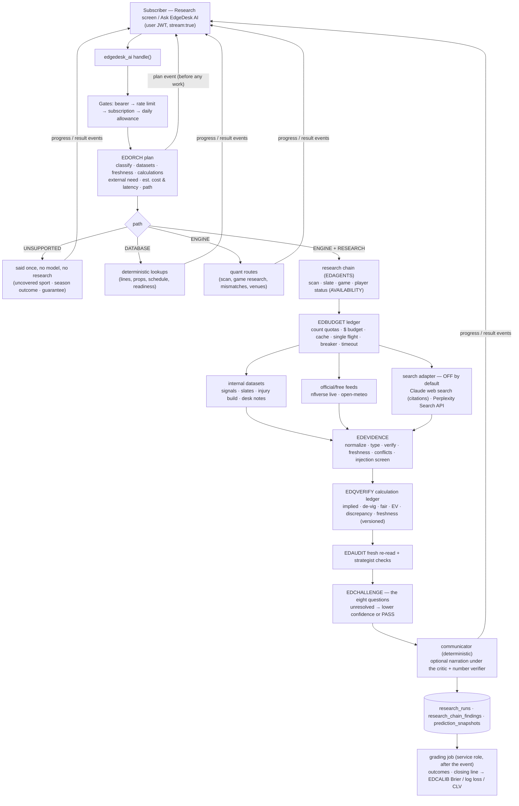

# Phase 4 — Autonomous research intelligence engine: audit, architecture, plan

Status: architecture and implementation plan. Each later stage of this branch updates the "Built" column of §6 and the tests in §8; nothing is described as working before a test shows it.

## 1. What exists today (audit, 12 October 2026)

### Code and deployment

| Item | State | Evidence |
|---|---|---|
| PR #551 (CI fix) | **merged** into `main` | `3b2b6fcf8` is an ancestor of `origin/main` |
| PR #552 (Phases 2–3: research chain, streaming, Research-screen UI) | **merged** into `main` | `f7029a8f9`, `092a71040` are ancestors of `origin/main` |
| Edge function `edgedesk_ai` | **not deployed since 29 Sep 2026** | The last `deploy-intelligence.yml` run is #16, on 29 Sep. It is the only workflow that runs `supabase functions deploy edgedesk_ai`. Production runs the pre-Phase-1 function. |
| `supabase/research_intel.sql` (Phase 2 memory) | **not applied** | Applied only by a manual `apply_research_intel` dispatch, which has never run |
| Website (`app.html` + `lib/`) | deploys with the static site | The Phase 3 UI is live wherever the site is served from `main`. It talks to the old function, which does not stream. |

### The server (`supabase/functions/edgedesk_ai/index.ts`, ~52.5k lines, no imports)

One self-contained Deno file. Pure kernels are inlined between marker pairs by `tools/presentation/inline.js`, which lets the same kernel run in the browser, in Node tests and in Deno. Claude is called over HTTP (`callModel`, `api.anthropic.com/v1/messages`). The default desk model is `claude-sonnet-5` (`EDGEDESK_AI_MODEL`).

`handle()` runs these gates in order:

1. bearer token;
2. `rateVerdict` (30/min, 300/h per user);
3. `subscriptionGate` (402 without an entitling row);
4. `usageClaim` (daily allowance, `ai_usage.sql`);
5. the deterministic turns: mine → opportunity → lines → props → **streamed research routes** → `quantTurn` → personnel/desk → the model-backed desk.

Research is a five-role chain (`_agents.js`, EDAGENTS: researcher → oddsmaker → strategist → auditor → communicator). It uses:

- the evidence graph (EDGRAPH);
- the disagreement engine (EDDISAGREE);
- the readiness model (EDREADY, five states);
- the adversarial price audit (EDAUDIT, 15 checks plus a fresh re-read);
- the fair-odds and fee engine (EDFAIR);
- calibration and backtests (EDCALIB: Brier, log loss, CLV, a walk-forward look-ahead guard).

Every external call goes through one ledger (`lib/edgedesk_research_budget.js`, EDBUDGET), which provides per-provider quotas, single flight, a topic-TTL cache, a circuit breaker, timeouts and a per-turn cost log.

**Streaming** (`stream: true`) returns NDJSON: `accepted` → `progress` (real stage events) → `result` | `error` | `fallback`. Cancelling stops the run at the next step.

### Data

| Source | Use | State |
|---|---|---|
| Supabase `signals` / `book_quotes` | captured prices (the market) | **frozen**: odds capture paused since the 10 Oct credit exhaustion (99,336 / 100,000), resumes 1 Nov (`supabase/odds_api_emergency_stop.sql`) |
| `football/nfl/slate.json`, `football/fbs/slate.json` | projections, ratings, starters, scenarios | committed nightly builds |
| `football/matchup/metrics.json` | NFL injury report + depth charts (nflverse) | committed build |
| nflverse injuries CSV (live, keyless) | fresher availability at L3 | through the ledger |
| `mlb_game_cards`, `games` | MLB probables and schedule | Supabase |
| desk notes | operator-recorded facts with a source | committed |
| open-meteo | weather (keyless) | through the ledger |

### Schema relevant to research

| Table / function | Purpose |
|---|---|
| `research_chain_findings` | per-user findings |
| `prediction_snapshots` | per-user predictions; refused at or after kickoff |
| `research_provider_quota` + `research_usage` (`research_usage_claim` / `_settle`) | per-provider count caps; paid providers disabled |
| `ai_usage_policy` / `ai_usage_events` (`ai_usage_claim` / `_settle`) | the reader's daily allowance |
| `quant_desk.sql` | candidates, audits, fair prices, execution costs, backtests |

All of these are additive and RLS-scoped. No auth, Stripe or entitlement objects are involved.

### Gaps against the Phase 4 brief

1. **No plan.** No question-level plan exists: complexity, datasets, freshness needs, cost/latency estimate and path are implicit in the route code, and the reader never sees them.
2. **Evidence types blur.** Findings carry reliability and verification, but not an explicit evidence *type* (confirmed fact / model estimate / external report / hypothesis), a freshness status, or an internal dataset identifier for non-URL data.
3. **Calculations are not records.** Numbers are deterministic, but a calculation is not a first-class record with its inputs, assumptions and version that the reader, the narration critic and the memory can all point to.
4. **The challenge is scattered.** The audit and the strategist ask most of the right questions, but there is no explicit challenge pass that answers the eight questions in one place and lowers confidence when contradictions remain.
5. **No live external search adapter.** Perplexity is registered *disabled*; Brave is listed but not wired; Claude web search is not used.
6. **No run record, no dollar budget.** There is no versioned research-run record (plan, sources, model and market snapshot, conclusions, cost), and no per-request or daily *dollar* budget (quotas are counts).
7. **No benchmark.** There is no benchmark measuring accuracy, citation validity, quantitative correctness, unsupported claims, latency and cost per request.

## 2. Architecture

### The data flow for one question

1. **Gates.** Unchanged and server-side. The browser never holds a provider key.
2. **Plan.** `EDORCH.plan(question, context)` is pure and costs nothing. It classifies the sport, league, teams, players and event (with the game id from the view when there is one). It sets complexity (`LOOKUP` / `STANDARD` / `INVESTIGATION`) and lists:
   - the datasets needed, with the freshness each requires;
   - whether external research is needed, and why;
   - the calculations to run;
   - the steps, each with a stage key, a provider, an estimated cost and estimated time.

   It picks the cheapest path that can answer reliably. The plan is streamed as a `plan` event before any work begins. Each `progress` event then names its stage, so the screen shows planned against actual. A planned step that did not run is marked `skipped` with the reason (for example, the provider disabled or the budget spent). No step is ever reported that did not happen.
3. **Work.** The existing routes do the work, through the ledger. External search runs only when the plan calls for it, the provider is configured and enabled, paid research is authorised (`EDGEDESK_RESEARCH_PAID_OK=1`), the provider's quota row allows it, and the dollar budget has room.
4. **Evidence.** Every fact — internal or external — becomes an EDEVIDENCE record:
   - source URL or `edgedesk://dataset/...` id;
   - retrieval and publication times;
   - team, player and game;
   - evidence type, verification status and freshness status;
   - conflicts with other evidence.

   External text is screened for prompt injection and is only ever data.
5. **Numbers.** Every betting number is an EDQVERIFY record: the function, its version, its inputs and assumptions, and its output. No language model supplies a probability or a price. Without a verified market, the market comparison is `UNAVAILABLE` and the matchup research continues.
6. **Challenge.** EDCHALLENGE asks the eight questions of the brief against the evidence and the calculation records. An unresolved important contradiction lowers research confidence; an unresolved critical one forces PASS.
7. **Answer.** The communicator writes the answer deterministically. Optional narration (off by default) passes the existing critic plus the number verifier: every number in the prose must be a calculation record's output.
8. **Memory.** A versioned `research_runs` row stores the question, plan, sources, model snapshot, market snapshot, conclusions, cost and latency. Outcomes and closing lines are written only by a service-role grading job after the event, so no future information reaches a prediction.

## 3. Routing: the cheapest reliable path

| Path | When | External cost | Example |
|---|---|---|---|
| `DATABASE` | the answer is a stored value | $0 | "What's the Bills spread?", "When do the Rays play?" |
| `ENGINE` | deterministic computation over stored data | $0 | best bet tonight, readiness, one game's research at L1/L2, mismatches |
| `ENGINE + RESEARCH (free)` | research from internal and free official feeds | $0 | L3 investigation with the nflverse live feed |
| `ENGINE + RESEARCH (search)` | a question that needs current reporting the datasets cannot hold (a breaking injury report, a coaching change) and the operator has enabled a search provider | ≈ $0.01–0.13 (§ PROVIDERS) | "Is there any news on Josh Allen's shoulder since this morning?" |
| `ENGINE + RESEARCH` (`AVAILABILITY`) | one player's status, or a club's starter | $0 | "Is Josh Allen playing Sunday?", "Who is pitching for the Rays tomorrow?" — each source's words with its time, any conflict named, never settled by guesswork |
| `UNSUPPORTED` | an uncovered sport, a season-long outcome, a guarantee | $0 | "Who will win the Super Bowl?" — says what it cannot do, before any route, desk or model (`outOfScopeTurn`) |

The model-backed general desk (existing, `claude-sonnet-5`) stays the last resort for conversation the deterministic routes do not cover. It is still gated by the daily allowance.

## 4. Providers (summary — full comparison in `PROVIDERS.md`)

- **Claude web search** (`web_search` server tool):
  - verified response shape;
  - every citation carries `cited_text`, up to 150 characters quoted from the page, so a claim can be checked against its own quote;
  - $10 per 1,000 searches plus tokens;
  - the recommended *deep* adapter.
- **Perplexity Search API**:
  - raw results (URL, title, snippet, date), $5 per 1,000 requests, no token charge;
  - the recommended *low-cost* adapter;
  - its schema could not be verified from the build environment (the documentation host does not resolve here), so it is implemented against the publicly described shape and marked unverified.
  - Perplexity's Sonar chat-completions endpoint was retired on 27 Sep 2026, so it is not used.
- **Official and free feeds** (nflverse, open-meteo) are kept.
- **MLB Stats API** is *not* added: its commercial-use terms could not be confirmed.

Every adapter is off by default and needs all of:

- its secret;
- `EDGEDESK_RESEARCH_PAID_OK=1`;
- its `research_provider_quota` row set to `enabled`.

## 5. Safeguards

| Safeguard | Mechanism | New or existing |
|---|---|---|
| Server-side auth and subscription | bearer, `subscriptionGate` | existing |
| Per-subscriber limits | daily allowance (`ai_usage_claim`); per-provider per-user daily count (`research_usage_claim`) | existing |
| Per-request and daily **dollar** budgets | `research_budget_policy` + `research_cost_claim()`; the ledger refuses a call whose estimate would cross the request budget | **new** |
| Provider circuit breakers | ledger breaker | existing |
| Caching and dedup | topic-TTL cache, single flight, investigation cache | existing |
| Concurrency | per-isolate and per-user concurrent-run caps | **new** |
| Cancellation and timeout | stream cancel; per-call timeout; 60 s client limit | existing |
| Structured logging | one JSON line per run: run id, path, steps, cost, latency (user id hashed) | **new** |
| Provenance | evidence records + calculation records + run record | **new** (extends existing) |
| Graceful degradation | provider failure → step `failed`, answer from what remains, named | existing, extended to search |
| Prompt injection | external text screened, quoted as data, never in a system prompt; extraction validated against verbatim quotes | **new** |

## 6. Implementation plan (stages, each reviewable and tested)

| # | Stage | Built |
|---|---|---|
| 0 | This audit, the provider comparison, the architecture | ✓ |
| 1 | `lib/edgedesk_orchestrator.js` (EDORCH) + the streamed `plan` event | ✓ |
| 2 | `lib/edgedesk_evidence.js` (EDEVIDENCE) + injection screen, applied to every finding | ✓ |
| 3 | `lib/edgedesk_quant_verify.js` (EDQVERIFY) calculation ledger + number verifier, attached to every priced candidate | ✓ |
| 4 | `lib/edgedesk_challenge.js` (EDCHALLENGE), applied before a VERIFIED CANDIDATE is published | ✓ |
| 5 | `lib/edgedesk_providers.js` (EDPROVIDERS) request builders and response parsers for Claude web search and the Perplexity Search API; ledger wiring; gated live-test script | ✓ |
| 6 | `supabase/research_engine.sql`: `research_runs`, `research_run_outcomes`, `research_budget_policy`, `research_cost_claim()`; run records written; evaluation over graded runs with EDCALIB | ✓ |
| 7 | Safeguards (dollar budget, concurrency, structured logs) + the odds recovery proposal and calculator | ✓ |
| 8 | Research-terminal UI: plan, sources, verification, contradictions, assumptions, confidence vs probability, why (not) actionable | ✓ |
| 9 | Benchmark of ≥ 100 questions through the real handler, metrics, cost and performance report (`tools/research/benchmark/`, `REPORT.md`); the defects it found fixed | ✓ |
| 10 | Deployment and rollback instructions (`DEPLOY.md`), risks (`RISKS.md`), full regression, PR | ✓ |

## 7. What this does not do

- **No automatic improvement.** No model learns from outcomes automatically. Graded runs feed measured calibration, Brier, log loss and CLV. Any model change stays a reviewed, versioned change.
- **No unattended odds spending.** Odds capture is not re-enabled. The recovery proposal is a document and a calculator only.
- **No deploying or merging** without the owner's approval.

## 8. Tests

Filled in stage by stage; see `docs/research-engine/REPORT.md` for results.
